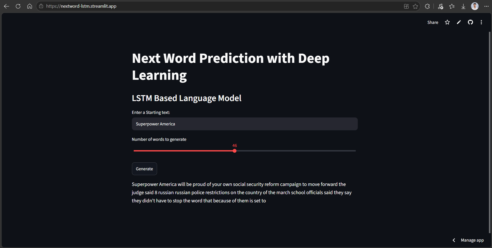

# Next Word Prediction with LSTM

An LSTM language model built with TensorFlow/Keras that generates text one word at a time from a starting phrase. Served through an interactive Streamlit app.

**[Live Demo](https://nextword-lstm.streamlit.app/)** · **[Dataset](https://www.kaggle.com/datasets/rmisra/news-category-dataset)**



## Overview

The model learns word sequences from news headlines and descriptions in the Kaggle News Category Dataset. Enter a starting phrase, choose how many words to generate, and the app repeatedly predicts the next word and appends it to the text.

## Model Architecture

```text
Input Text → Tokenization & Padding → Embedding (128) → LSTM (256 units) → Dense (Softmax) → Next Word
```

| Component | Detail |
|---|---|
| Embedding | 128 dimensions |
| LSTM | 256 units |
| Output | Dense layer with softmax over the vocabulary |
| Training | 30 epochs |

## Training Results

| Metric | Result |
|---|---:|
| Training accuracy | ~77% |
| Validation accuracy | ~10% |

The large gap between training and validation accuracy shows the model is overfitting: it memorizes training sequences and generalizes poorly to unseen text. Validation accuracy is naturally low for next-word prediction, since many different words can be valid continuations, but a gap this size still points to overfitting.

## Limitations

- Generated text is often grammatically loose and not coherent over longer outputs.
- The model is trained only on news-style text, so it works best with news-like prompts.
- Words outside the training vocabulary are ignored.

## Future Improvements

- [ ] Add dropout regularization
- [ ] Use early stopping
- [ ] Train on more data
- [ ] Try a bidirectional LSTM
- [ ] Tune hyperparameters
- [ ] Add temperature or top-k sampling for more varied output

## Tech Stack

Python · TensorFlow / Keras · NumPy · Streamlit · Pickle

## Project Structure

```text
NextWord-LSTM/
├── app.py               # Streamlit app
├── nextword_model.h5    # Trained model (stored with Git LFS)
├── tok.pkl              # Fitted tokenizer
├── requirements.txt
├── .gitattributes       # Git LFS tracking rules
└── README.md
```

The training dataset is not included in this repository. Download it from [Kaggle](https://www.kaggle.com/datasets/rmisra/news-category-dataset) if you want to retrain the model.

## Getting Started

The model file is stored with [Git LFS](https://git-lfs.com/). Install it before cloning, or the `.h5` file will download as a small pointer file instead of the real model.

```bash
git lfs install
git clone https://github.com/shreyas-650/NextWord-LSTM.git
cd NextWord-LSTM
```

Create and activate a virtual environment:

```bash
python -m venv .venv

# Windows (PowerShell)
.\.venv\Scripts\Activate.ps1

# Linux / macOS / WSL
source .venv/bin/activate
```

Install dependencies and run the app:

```bash
python -m pip install -r requirements.txt
streamlit run app.py
```

## Usage

1. Enter a starting phrase.
2. Select the number of words to generate.
3. Click **Generate**.

## 🔗 Author

**Shreyas Singh** · [GitHub](https://github.com/shreyas-650)